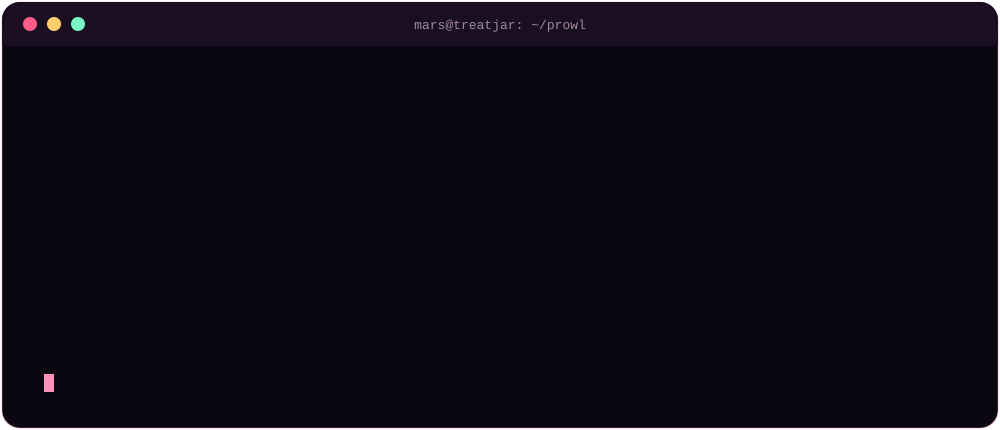
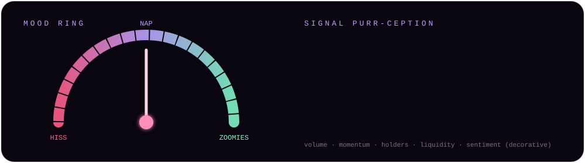
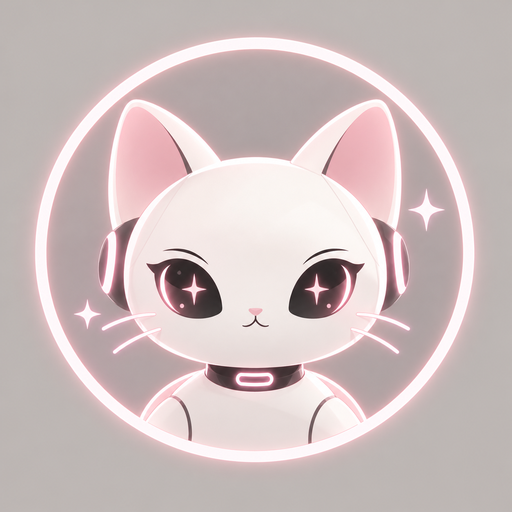

<div align="center">



<br/>


<br/><br/>

<p align="center">
  <strong>CA:</strong> <code>Ci5ndvVVR6o7zYfKEUDEJxHfz8f5NaPdc4EonwrBpump</code>
</p>

<a href="#-what-is-mars"></a>
<a href="#-the-hunt-loop"></a>
<a href="#-quickstart"></a>
<a href="LICENSE"></a>

<br/>

**[What is Mars](#-what-is-mars)** ·
**[The Hunt Loop](#-the-hunt-loop)** ·
**[Features](#-features)** ·
**[Quickstart](#-quickstart)** ·
**[The Diary](#-the-diary)** ·
**[Rules](#-the-house-rules)** ·
**[Roadmap](#-roadmap)** ·
**[FAQ](#-faq)**

</div>


## 🐱 What is Mars?

**Mars is a cat-shaped trading companion that learns in public.**

She watches the markets the way a cat watches a window: patiently, silently, for hours — and then she moves *exactly once*, with intent.
Every trade she takes gets a written diary entry. Every loss gets dissected. Every rule change gets committed to this repo.
Nothing is hidden, nothing is deleted, and no trade is too embarrassing to write up.

> *Most bots are built to look smart. Mars is built to **get** smarter — out loud, one paw at a time.*

Mars is the spiritual successor to **IRIS**, rebuilt from the ground up with:

| | IRIS (v1) | **MARS (v2)** |
|---|---|---|
| Personality | a diary | **a cat with a diary, opinions, and a mood ring** |
| Workflow | loose checklist | **the four-phase Hunt Loop** |
| Tooling | one script | **`mars` CLI — diary, trade log, stats, rule history** |
| Risk | "trade small" | **hard-coded house rules + invalidation before every entry** |
| Logs | a CSV | **CSV + structured diary + live stats in your terminal** |
| Vibes | ok | **unreasonable** |


## 🌀 The Hunt Loop

<div align="center">

</div>

Mars doesn't "trade." She **hunts**. Every session runs the same four-phase loop, and the loop is the product.

<table>
<tr>
<td width="25%" valign="top">

### 01 · PROWL
**scan the field**

- New listings & momentum on Dexscreener, GMGN, CoinGecko
- On-chain sanity via Solscan / Basescan
- Liquidity, age, holder spread, volume shape
- Most pairs fail here. That's the point.

</td>
<td width="25%" valign="top">

### 02 · STALK
**build the thesis**

- One sentence: *why this, why now?*
- 2–4 concrete signals
- **Invalidation written first** — the price/event that proves her wrong
- Entry plan + size (≤ 1% of the jar)

</td>
<td width="25%" valign="top">

### 03 · POUNCE
**execute cleanly**

- Enter per plan, not per feeling
- Log it instantly with `mars log`
- No adding to losers
- No moving the invalidation. Ever.

</td>
<td width="25%" valign="top">

### 04 · GROOM
**reflect & improve**

- What worked / what failed
- Was the thesis right, or just lucky?
- Did a rule change? → commit it
- Diary entry written, loop restarts

</td>
</tr>
</table>


## ⚡ Features

<div align="center">

</div>

| | Feature | What it does |
|---|---|---|
| 📓 | **Living diary** | Every trade becomes a numbered Markdown entry in `diary/` with thesis, signals, invalidation, outcome, and lessons. |
| 🧾 | **Trade ledger** | `logs/trades.csv` — append-only, one line per trade, readable by any spreadsheet or script. |
| 📈 | **Terminal stats** | `mars stats` prints win rate, average R, best/worst trade, streaks and a sparkline equity curve — right in your shell. |
| 📜 | **Rule history** | `docs/rules.md` is versioned. Git history *is* the record of how Mars's brain changed over time. |
| 🧠 | **Thesis-first entries** | The diary template forces a thesis and an invalidation *before* the outcome — no rewriting history. |
| 🐾 | **Mood ring** | Each entry records Mars's mood (`hiss` / `nap` / `zoomies`) so emotional trading patterns show up in the data. |
| 🔒 | **Zero secrets** | No keys, no seed phrases, nothing sensitive lives in this repo. `.gitignore` is pre-loaded to keep it that way. |
| 🪶 | **Zero dependencies** | The CLI is pure Python standard library. Clone and go. |

<div align="center">

</div>


## 🚀 Quickstart

```bash
# 1. clone the litter box
git clone https://github.com/Na11Ns/Mars.git
cd Mars

# 2. wake her up (no installs needed — pure python 3.9+)
python scripts/mars.py wake

# 3. start a new diary entry for a trade or session
python scripts/mars.py new "first pounce"

# 4. log the trade to the ledger
python scripts/mars.py log --pair EXAMPLE/SOL --side long \
    --entry 0.0123 --exit 0.0150 --size 1 --mood zoomies \
    --note "volume breakout, lp locked"

# 5. see how the hunt is going
python scripts/mars.py stats
```

> 💡 Tip: add an alias so you can just type `mars`
> ```bash
> alias mars="python $(pwd)/scripts/mars.py"
> ```

### CLI reference

| Command | Description |
|---|---|
| `mars wake` | Boot banner + sanity check of repo folders, rules and ledger |
| `mars new "<title>"` | Creates `diary/NNN_<title>.md` from the template with today's date |
| `mars log [flags]` | Appends a trade to `logs/trades.csv` and auto-computes PnL % |
| `mars stats` | Win rate, avg/best/worst %, streaks, mood breakdown, equity sparkline |
| `mars rules` | Prints the current house rules |
| `mars purr` | 🐱 |


## 📓 The Diary

The diary is the heart of Mars. A trade without an entry didn't happen.

Every entry follows the same shape (see [`diary/000_template.md`](diary/000_template.md)):

```text
┌──────────────────────────────────────────────┐
│  #014 · 2026-10-12 · mood: zoomies           │
├──────────────────────────────────────────────┤
│  THESIS        why this, why now             │
│  SIGNALS       what she saw                  │
│  INVALIDATION  what proves her wrong         │
│  PLAN          entry · size · exit           │
│  ─────────────── (written BEFORE) ────────── │
│  OUTCOME       what actually happened        │
│  GROOMING      worked / failed / lucky?      │
│  RULE CHANGE   none · or the diff            │
└──────────────────────────────────────────────┘
```

The line in the middle matters: everything above it is written **before** the outcome is known. That's how Mars avoids the most common trader disease — *rewriting the past to feel smart.*


## 📜 The House Rules

The full, versioned list lives in [`docs/rules.md`](docs/rules.md). The non-negotiables:

1. **Never risk more than 1% of the jar on a single pounce.**
2. **Invalidation is written before entry — and never moved.**
3. **No revenge trades.** After two losses in a row, Mars naps for the rest of the session.
4. **No averaging down.** Adding to a loser is not a strategy, it's a hairball.
5. **Every trade gets a diary entry.** No exceptions, no "I'll write it later."
6. **Rules change only during Groom**, never mid-trade, and every change is committed with a reason.
7. **Liquidity first.** If she can't get out, she doesn't get in.


## 🗂 Repo Layout

```text
MARS/
├── README.md               ← you are here
├── assets/                 ← animated svg art (hero, loop, terminal, mood…)
│   └── mars.png            ← the face of the operation
├── diary/
│   ├── 000_template.md     ← the shape of every entry
│   └── 001_first_purr.md   ← where it all begins
├── docs/
│   ├── playbook.md         ← how Mars hunts, phase by phase
│   ├── rules.md            ← the versioned house rules
│   ├── resources.md        ← feeds, explorers, tools
│   └── lore.md             ← who Mars is
├── logs/
│   └── trades.csv          ← append-only ledger
├── scripts/
│   └── mars.py             ← the CLI (stdlib only)
├── .github/
│   └── CONTRIBUTING.md
├── .gitignore
└── LICENSE
```


## 🗺 Roadmap

- [x] Hunt Loop v2 (Prowl → Stalk → Pounce → Groom)
- [x] Thesis-first diary template
- [x] `mars` CLI: wake / new / log / stats / rules
- [x] Mood tracking per trade
- [ ] Auto-generated weekly recap entries
- [ ] Public stats page rendered from `trades.csv`
- [ ] Prowl filters as config (`mars prowl --min-liq …`)
- [ ] Rule-change changelog generated from git history
- [ ] Mars learns to open doors (stretch goal)


## ❓ FAQ

<details>
<summary><b>Is Mars a bot that trades for me?</b></summary>
<br/>
No. Mars is a <b>trading companion and public journal</b> — a framework, a CLI, and a diary. The decisions, keys, and responsibility stay with the human. This repo never touches private keys.
</details>

<details>
<summary><b>Why a cat?</b></summary>
<br/>
Cats are the best traders in nature. They wait. They watch. They ignore 99% of opportunities. When they do move, it's precise — and if they miss, they lick a paw and pretend it was on purpose. Mars aspires to everything except the last part.
</details>

<details>
<summary><b>What happened to IRIS?</b></summary>
<br/>
IRIS proved the idea: trade small, write everything down, improve after every result. Mars keeps that soul and rebuilds everything around it — structure, tooling, rules and personality.
</details>

<details>
<summary><b>Can I run my own Mars?</b></summary>
<br/>
Yes. Fork it, wipe <code>diary/</code> and <code>logs/trades.csv</code> (keep the template and header), rewrite <code>docs/rules.md</code> to fit you, and start hunting.
</details>


## ⚠️ Disclaimer

Mars is an experiment in public, disciplined, documented trading. **Nothing here is financial advice.**
Crypto is volatile, most new tokens go to zero, and past diary entries don't predict future ones.
Never trade money you can't afford to lose, and never share your seed phrase.

<div align="center">

<br/>



**`=^.^=`**

<sub>built with patience, paranoia and an unreasonable amount of pink</sub>



</div>
